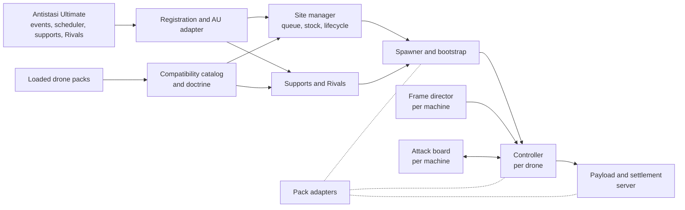
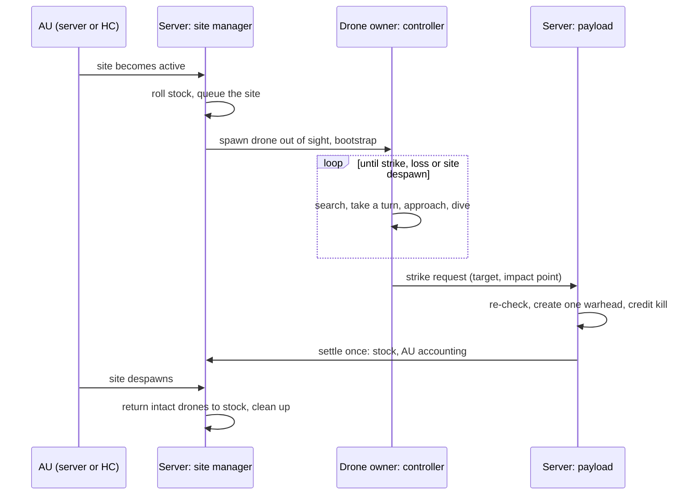

# Architecture overview

This page explains how [A3UE] AI FPV Drones is put together. It is conceptual: it names the main functions so you can find them, but it doesn't walk through the code. The detail pages are:

- [Flight model](flight-model.md): how a drone flies, attacks and recovers.
- [Drone packs](drone-packs.md): how the supported drone mods are detected and adapted.
- [Antistasi integration](antistasi-integration.md): how the mod plugs into Antistasi Ultimate.

## In one paragraph

The mod is one SQF addon (`fpv_ai_drones.pbo`) with no hard dependency on any drone pack.
- **Launch:** when Antistasi Ultimate (AU) activates an enemy site, the server decides whether that site has drones. It spawns them from whichever drone packs are loaded, out of sight of players.
- **Control:** each drone gets one autonomous controller on the machine that owns it.
- **Attack:** the controller lets Arma's AI fly the drone while it searches and approaches. It takes over steering for the attack run and dive.
- **Strike:** it fires exactly one warhead when the drone actually reaches its target.
- **Shared parts:** the same managed drone is reused for site defence, the FPV enemy support and the Rivals drone attack.

## Building blocks

| Block | What it does | Main functions |
|---|---|---|
| **Registration and AU adapter** | Runs at mission start. It subscribes to AU's site and vehicle events on the AU 12.0 and 12.4 event systems. It installs the site, support and Rivals hooks, and logs a startup summary of what is active | `addFPVEventListeners`, `installSiteHooks`, `reportAUAdapter` |
| **Compatibility catalog and doctrine** | Finds which drone packs are loaded and builds the list of usable drone classes per side and role. Doctrine says, per site type, how likely drones are, how many, which roles and which packs | `buildCompatCatalog`, `buildDoctrine`, `getProfile` |
| **Site manager** | Tracks which enemy sites are active, rolls and keeps each site's drone stock, and deploys drones one site at a time from a server queue | `onLocationSpawned`, `processSiteQueue`, `siteStock`, `managerEvaluateSite` |
| **Spawner and bootstrap** | Places the drone (out of sight, its own launch slot), creates its crew, undoes the pack's "player only" setup and starts its controller | `spawnManagedDrone`, `launchStandoff`, `launchSlot`, `bootstrapLocal` |
| **Controller** | One per drone, on the machine that owns it. It searches, picks targets, approaches, dives, fuses and handles misses. See the [flight model](flight-model.md) | `runController` and the `attack*`, `trajectory*`, `terminal*` helpers |
| **Frame director** | One per machine. It steps attacking drones every frame within a time budget, so dives stay smooth when the server is busy | `directorFrame` |
| **Attack board** | One per machine. It decides, per target, which drone attacks now and which wait in overwatch | `attackSlot`, `overwatch`, `clearTarget` |
| **Payload and settlement** | On the server: creates the one warhead, credits the kill and settles the drone's lifecycle, stock and AU accounting exactly once | `commitDetonation`, `endLifecycle`, `consumePool` |
| **Pack adapters** | Small, targeted wrappers around each drone pack's own scripts (warheads, fiber cable, radio signal, targetability) | `install*Adapter` |
| **Supports and Rivals** | Adds the FPV strike to AU's Occupant and Invader supports and swaps the Rivals drone event for a real FPV | `patchSupportRegistries`, `SUP_FPV`, `installRivalsHooks` |

## A drone's life

1. **Activation.** AU spawns a site's garrison and raises its "location spawned" event. Sites at war with the players (Occupants or Invaders) are eligible.
2. **Stock.** The first time a side holds a site in a session, the server rolls that site's chance and stock from doctrine.
   - Destroyed or spent drones deplete the stock; one drone refills every 15 minutes by default.
   - The frequency, drones-per-site and refill [settings](../README.md#settings) adjust these rolls.
   - A captured site starts fresh.
   - Nothing is written to the AU save.
3. **Deployment.** The server queue deploys a site's drones in turn.
   - Launch points are at least 800 m from hostile players. Drones held back because no safe point exists retry later.
   - Drones launched together get separate slots so they never collide on take-off.
4. **Bootstrap.** Drone packs are built for a human pilot, so they switch the AI off. The bootstrap turns it back on, applies the pack adapters and starts exactly one controller.
5. **Flight.** See the [flight model](flight-model.md).
6. **Strike and settlement.**
   - The owner asks the server to detonate.
   - The server re-checks the target and the drone's lifecycle, then creates the warhead with the right shooter for kill credit.
   - It settles the drone once. A drone that strikes is consumed; AU does not refund it as a surviving asset.
7. **Despawn.** When AU despawns the site, intact drones are retired and returned to the site's stock. Their crew, group and markers are cleaned up.

## Multiplayer and authority

- **The server decides.**
  - Spawning, stock, the drone's lifecycle, the payload and all accounting run on the server.
  - Clients never spawn drones or settle outcomes, and requests from a client cannot change a drone's state.
  - Remote calls check who sent them, and late joiners do not replay old requests.
- **The controller runs where the drone is local.** Normally that is the server.
  - If locality moves (for example a player takes direct control), the old controller stops.
  - A new one takes over from the drone's real state.
  - Generation and owner checks stop a stale controller from writing.
- **One writer at a time.** In each phase exactly one thing moves the drone: Arma's AI while searching and approaching, the controller during the attack run and dive.
  - Under direct player or Zeus control, the controller writes nothing at all.
- **Exactly once.** One warhead per strike and one settlement per drone, even when a pack's own hit handler, a kill and a deletion race each other.
- **Headless client.** AU may run the site garrisons on a headless client. The drones are still spawned and flown by the server. See [Antistasi integration](antistasi-integration.md#headless-clients).
- **Replicated state.** A small set of `A3UE_FPV_*` object variables (mode, target, link state, site) is shared so that clients and late joiners can show the right effects.
  - Clients never run guidance.

## Performance

The mod is designed for a busy AU server at about 30 FPS, where AU itself already uses much of the script scheduler.

- **Only attacking drones cost frame time.**
  - The frame director steps a drone each frame only while it is diving, or cleared to attack and within 450 m.
  - It stops after 2.5 ms per frame (`A3UE_FPV_frameBudgetMs`); any remaining drones go first next frame.
- **One attacker per target.** The attack board keeps the number of diving drones small by design. The others circle in overwatch at low cost.
- **Everything else is scheduled and lean.**
  - Idle and waiting drones wake a few times a second.
  - Target search uses one shared entity scan per site, not one per drone.
  - The radio link check reuses the relays it found for 10 s.
- **Spawn-time work is bounded**: a fixed number of candidate points, line-of-sight tests and water checks.
- **Network:** link state is sent on change. Coordination data (the attack board and scan caches) is never broadcast.

Measured on a dedicated server with about 20 drones and AU's full site load (one player):
- server FPS stayed at 45–47;
- the director averaged 1.4–3 ms in frames with a drone diving;
- dives were stepped every 23–44 ms with no late steps.

**Many dives at once.** One drone attacks each target at a time, but separate targets (players more than 25 m apart) each get their own attacker.
- **The budget is shared.** On the dedicated server one dive step cost about 2.4–2.8 ms, so the 2.5 ms budget fits roughly one step per frame. With N drones diving at once, each is stepped about every N frames.
- **Estimated effect at about 47 FPS:**
  - 5 divers: about 9 steps a second each, close to the fuse limit;
  - 10 divers: about 5 a second, so dives look rougher and miss more often.
- **Server FPS is held.** Drones don't freeze, and a drone left without a step for 0.5 s is stepped by its own script.
- **What's measured:** two simultaneous divers, hosted, with up to 3 frames over budget per 10 s. Larger numbers are estimates.
- **Ways to raise the limit:** a larger `A3UE_FPV_frameBudgetMs` where the server has headroom, and a planned leaner dive step.

## Diagnostics

All lines go to the RPT log of the machine that runs the code (the server for almost everything) and start with `[A3UE_FPV]`.

| Line | What it tells you |
|---|---|
| `A3UE FPV AU adapter SUMMARY` | At start-up: AU version, which hooks are active and which drone packs were found |
| `siteDeploy`, `siteRecover`, `siteMonitor` | A site's drones were deployed, a missed site activation was recovered, or the queue looks stuck |
| `supportDeploy`, support refusal lines | An FPV support launched, or why one was refused (war tier, no safe launch point, no visible target, ...) |
| `wing` | The attack board: which drone was cleared to attack, swaps, timeouts and outcomes |
| `attackPass` | One line per dive: approach profile, intended outcome, closest distance, result and step timing |
| `director` | Every 60 s while drones fly: frame cost, budget overruns and scheduler lag |
| `droneLost` | A drone was shot down or destroyed, and by what |

From the debug console, `copyToClipboard str (call A3UE_fnc_fpv_debugSnapshot)` copies the live state: registry, sites, supports and drones. Setting `A3UE_FPV_debug = true` on the server adds verbose logging. Don't leave it on for performance tests.

## Settings

The player-facing settings are CBA settings, listed in the [README](../README.md#settings). How they work:

- **Registration:** `fn_fpv_registerSettings` declares them in CBA's preInit on every machine, the way AU registers its own. Every one is a global (server) setting: the server's value applies to everyone, and only the host or a logged-in admin can change it.
- **Storage:** CBA stores each value as a mission variable of the same name, for example `A3UE_FPV_siteFrequency`.
- **Validation:** `fn_fpv_userSetting` is the one reader. It validates every value and falls back to the default, so a bad entry in `cba_settings.sqf` can't produce an out-of-range value. Without CBA the defaults apply.
- **Where each applies:**
  - frequency and drones per site: where a site rolls its stock (`fn_fpv_siteStock`);
  - refill: on every stock use;
  - FPV strikes and their war level: `fn_fpv_supportAllowed`, which every FPV support request passes and which the attack-wave override asks before offering FPV;
  - Rivals: the Rivals availability check.
- **Logging:** the server logs `[A3UE_FPV] setting <name>=<value>` at start-up and on every change.

## Tuning (advanced)

The values below aren't in the settings menu. They are mission variables read live on the server.

- To set one, run `missionNamespace setVariable ["A3UE_FPV_attackersPerTarget", 2]` in the debug console with **Server Exec**, or put it in a server-side init script.
- They are unsupported and may change between versions.

| Variable | Default | Effect |
|---|---|---|
| `A3UE_FPV_attackersPerTarget` | `1` | Drones allowed to attack one target at once; `0` turns turn-taking off |
| `A3UE_FPV_attackFollowUpDelay` | `2.5` | Seconds before the next drone is cleared after an attack ends (plus 0–1 s) |
| `A3UE_FPV_overwatchRadius` | `140` | Inner radius of the overwatch ring, metres |
| `A3UE_FPV_attackSpeedScale` | `1` | Dive speed: `0` is the old slow dive, `1` the tuned table, up to `1.5` |
| `A3UE_FPV_attackReversal` | `true` | Allow the one "flip back" after a close miss |
| `A3UE_FPV_launchStandoff` | `800` | Minimum launch distance from hostile players, metres |
| `A3UE_FPV_frameBudgetMs` | `2.5` | Frame director time per frame, ms (0.5–10) |
| `A3UE_FPV_frameDriver` | `true` | `false` steps every drone from the scheduler only (slower dives under load) |
| `A3UE_FPV_perfLog` | `false` | `director` line every 10 s instead of 60 s |

## Compatibility

- **Arma 3:** the declared minimum is 2.14; development and testing are on 2.22.
- **Antistasi Ultimate:** tested on 12.0.3 and 12.4.1.
  - The mod checks AU's functions at start-up and logs what it found.
  - It never switches features off just because an AU version is newer than the tested ones.
  - A hook that can't be installed falls back to AU's normal behaviour and is named in the start-up summary.
- **CBA:** required by AU. This mod uses AU's event system, which runs on CBA events from AU 12.4.
- **Drone packs:** detected at runtime; none is a hard dependency. See [Drone packs](drone-packs.md).
