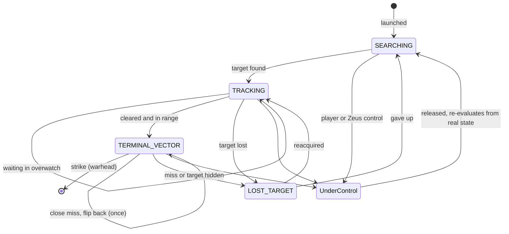

# Flight model

How a managed FPV drone flies, from launch to strike. For where this sits in the mod, see the [architecture overview](architecture.md).

## Design goals

- **It should feel like a pilot is flying it.** The drone commits, speeds up and dives, refining its aim on the way down.
  - The drone doesn't hit every time.
  - When it just misses, it should feel like "that just missed me": late, over the head or beside you.
- **Counterplay is earned, not rolled.** Moving targets are harder to hit because the simulated pilot reacts late, not because of a dice roll at impact.
- **Nothing is faked.**
  - A hit is a real contact or a real predicted impact.
  - A ground strike is real ground contact.
  - A miss is a real pass.
  - There is no teleporting, no guaranteed hit and no explosion added on top of a pack's own warhead.
- **Smooth at server frame rates.** A dive has to stay smooth at about 30 FPS on a busy server, and degrade gracefully below that.

## Who flies the drone

The drone is a real Arma UAV with an AI crew. Two writers share the flying, never at the same time:

| Phase | Mode | Who moves the drone |
|---|---|---|
| Launch and transit | `IDLE` / `SEARCHING` | Arma's AI: flies to points the controller gives it, at a height that clears trees |
| Searching | `SEARCHING` | Arma's AI: circles the site at search height |
| Waiting its turn | `TRACKING` (overwatch) | Arma's AI: flies a ring round the target |
| Approach | `TRACKING` | Arma's AI: flies to a predicted intercept point |
| Attack run and dive | `TERMINAL_VECTOR` | **The controller**: sets the velocity and body attitude every step |
| Lost target | `LOST_TARGET` | Arma's AI: flies to where the target was last predicted and searches again |

The AI is good at getting around terrain at moderate speed. It cannot fly a fast, precise dive, so the controller takes over for the last few hundred metres.

`UnderControl` is not a controller mode. Autonomy is paused from any mode while a player or Zeus flies the drone (see [Player and Zeus control](#player-and-zeus-control)).

## Launch and transit

- **Out of sight.** Drones spawn at least 800 m from any hostile player, preferring points without a line of sight to them. They never appear overhead.
  - If no safe point exists yet, the site tries again later.
- **Separate slots.** Drones launched together are spread across the launch heading in 30 m steps, each a little higher, so they don't collide on take-off.
- **Above the trees.** Arma's AI holds a height above the terrain, not above the trees. The controller sets a minimum transit height of 35 m above ground. A forward probe twice a second spots tall obstacles ahead and raises that height to clear them.

## Search and target selection

- **Shared scan.** Every 1.5 s, one entity scan per site finds candidates for all of that site's drones. A drone that has flown outside the site area also scans its own 250 m around itself.
- **Legal targets only.**
  - Only sides hostile to the drone's side count, read live, so a side that becomes friendly drops out at once.
  - Empty vehicles, statics and captives are ignored.
- **Role.** Anti-tank drones prefer vehicles; anti-personnel drones prefer infantry.
- **Line of sight** is traced only for the six best candidates.
- **Spreading.** A target already being attacked or watched scores lower (700 points per drone). Drones arriving one by one split over the targets they can see.
- **Commitment.** Once a drone has a legal target it keeps it, even if the target ducks behind cover. It doesn't wander off at the first obstruction. Empty vehicles and targets that become illegal are dropped.

## Taking turns: the attack board

Several drones diving at one group at once would kill each other and swamp the server. Each machine keeps an attack board:

- **One attacker per target** (`A3UE_FPV_attackersPerTarget`, default 1). The first drone to find a target is cleared at once.
- **The rest wait in overwatch**, on a ring 140, 155 or 170 m out, a little above transit height. Each drone has its own place on the ring and flies to a point 45° ahead of it, so the waiting drones circle.
- **Follow-up.** After every outcome (strike, shot down, miss, target lost), the closest waiting drone is cleared 2.5–3.5 s later. It dives from the ring in about 6 s, so a target sees an attack roughly every 9 s.
- **Shared attacks.** Targets within 25 m of each other share one attack, so a warhead aimed at one player doesn't also take the drone attacking the player next to them.
- **Giving way.**
  - A cleared drone that is still far out hands its turn to one at least 150 m closer.
  - A cleared drone that stays close for 20 s without diving goes to the back of the queue.
- **Retargeting.** A waiting drone looks again every 5 s. It leaves only for a much less crowded target.

## Approach

Arma's AI flies a lead-predicted intercept towards the target at the doctrine's tracking speed. Each engagement samples one **approach profile**:

| Profile | Shape |
|---|---|
| `DIRECT` | Straight in, with the pilot's weave in the dive |
| `HIGH_DIVE` | Holds height until close, then a steep dive |
| `FLANK` | Comes in from 30–70° off the direct line, then curves onto the target |

The profile changes only where the approach and dive start. Targeting, commitment and support rules stay the same.

## The attack run and dive

At the hand-off point (180–350 m out, from speed and limits) the controller takes over. Every step it:

1. **Plans a smooth path.** A curved path runs from the drone's current position and heading to the aim point, re-planned as the target moves. Its limits are physical and in SI units: speed, acceleration, braking, sideways acceleration, descent rate and turn rate.
2. **Commits to the run.** The drone accelerates hard to its family's dive speed:

   | Family | Anti-personnel | Anti-tank |
   |---|---|---|
   | Crocus | 34 m/s (122 km/h) | 32 m/s |
   | KVN | 30 m/s (108 km/h) | 28 m/s |
   | Ukraine FPV | 28 m/s (101 km/h) | 26 m/s |

   The descent limit scales with speed, so steep dives are possible.
3. **Flies a simulated pilot's aim point**, not the target itself:
   - **Reaction time.** The pilot re-reads the target every 0.25–0.4 s and dead-reckons in between. A late change of direction is seen late. A sprinting player or a manoeuvring vehicle can make the drone miss, or hit the ground beside them.
   - **Correction weave.** The aim starts slightly off and is corrected in shrinking, usually alternating steps (left, then right but closer, then a smaller correction). The drone weaves gently as it closes and banks into each correction.
   - **Intended outcome.** Each pass has an intended end point, sampled once per pass:

     | Intent | Where the pilot ends up aiming |
     |---|---|
     | `DIRECT` | The target (most passes) |
     | `GROUND_SHORT`, `GROUND_SIDE` | The ground 1–3 m short of or beside the target |
     | `OVER` | Just over a soldier's head (vehicles get a ground strike instead) |

     Moving targets get fewer direct intents. In the final half-second or so, the aim blends from the weave to the intended point.
4. **Clears obstacles.** A probe along the dive line finds trees or buildings in the way and lifts the path over them.
5. **Sets the attitude.** The nose follows the flight path and the drone banks up to 30° in turns, rolling smoothly.

All random choices (profile, intent, weave) are drawn once per pass from a small seeded generator stored with the pass, never per frame. QA can force each choice for testing.

## Fuse

The fuse is contact-driven. It checks every dive step:

| Rule | Fires when |
|---|---|
| Direct contact | The drone is within about 1 m of a soldier or 1.4 m of a vehicle hull |
| Predicted impact | The drone will reach the target before the next step |
| Ground near target | A ground intent actually reaches the ground near its chosen point |
| Obstruction | The target is behind cover and the drone hits the cover |
| Air proximity | The target is an aircraft and the drone is close enough |

There is **no proximity rescue** for ground targets. A drone that passes close without touching flies past; it doesn't explode next to you.

When the fuse fires, the owner sends the strike to the server. The server creates the warhead, so there is one warhead with the right kill credit. See [Drone packs](drone-packs.md#warheads) for which warhead is used.

## Missed pass: the flip back

After a genuine close miss (closest approach within about 8 m, no contact, payload intact), the drone may turn round once:

- **Pull up and over.** It climbs while braking hard, goes over the top at low speed and dives straight back. This is what a real pilot does at 30 m/s; flat braking would carry it 20–30 m. It overshoots by about 15–21 m and turns in under 2 s.
- **Conditions.** Link OK, not under player control, target still legal, and enough height and clear space to climb.
- **The return pass is a new pass.** It re-samples its intent, mostly direct this time, since the pilot is close and slow.
- **One flip per drone, ever.** The budget is stored on the drone, so a control takeover or a new controller can't reset it.
- **Otherwise** the drone goes to `LOST_TARGET`, flies to where the target was predicted and searches again.

## Frame rate and server load

- **The frame director** steps attacking drones once per frame, within a 2.5 ms budget per frame. Waiting and searching drones run on the normal script scheduler at lower rates.
- **Real elapsed time.** Each step integrates the real time since the last one. A late step never integrates more than 0.25 s, so a stall shows as a short slow-down, never as a jump.
- **Fallback.** If the director hasn't stepped an attacking drone for 0.5 s, its own scheduled script steps it.
- **Fuse limit.** The fuse windows cover one frame down to about 9 FPS against a soldier and 6 FPS against a vehicle. Below that, a contact between two frames can be missed.

## Player and Zeus control

- If a player or Zeus takes direct control of a drone, the controller stops writing at once: no steering, no targeting, no fuse. A passive UAV terminal connection is not direct control.
- When control is released, the drone carries on from its real position and speed, not from the old plan.
- The flip budget and lifecycle are kept across the takeover.

## Radio link (radio packs)

- Ukraine FPV and Crocus drones are radio drones. Each controller samples its link about once a second, using jammers and relays (retranslators) from the packs.
  - A weak link degrades the drone.
  - A jammed link makes it hold and wait.
- KVN drones are fiber-optic and are not affected by jammers.

See [Drone packs](drone-packs.md).

## Tuning status

The dive speeds, intent weights, weave sizes and overwatch distances are tuned by eye in real games. They may change between versions. See [Tuning (advanced)](architecture.md#tuning-advanced) for the values a server can change.
